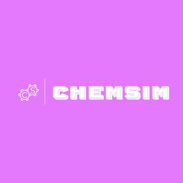

# 🧪 ChemSim — Making Chemistry Interactive

<p align="center">
  
</p>

<p align="center">
  <b>Learn. Experiment. Play. Discover.</b>
  <br/>
  An interactive chemistry learning platform designed to make understanding chemistry engaging through simulations, games, and virtual experiments.
</p>

<p align="center">
  🏆 CBSE National Science Exhibition Winner (2022–23)
  <br/>
  🥇 RBVP Competition Winner (2022–23)
</p>

---

## 🌟 The Story Behind ChemSim

What if learning chemistry felt less like memorising a textbook and more like exploring a laboratory?

That was the idea behind **ChemSim**.

Developed during my high school years, ChemSim was an attempt to bring chemistry education into an interactive digital environment. Instead of relying entirely on traditional learning methods, the application combines gamification, virtual laboratory experiments, visual demonstrations, and interactive assessments.

The project went on to win recognition at the **CBSE National Science Exhibition and RBVP competitions in 2022–23**.

It was one of my earliest experiences of turning an idea into a complete working product, and one of the projects that sparked my interest in building software that solves real-world problems.

## 🚀 Features

### 🔬 1. Virtual Chemistry Lab
An interactive environment designed to help students understand qualitative chemical analysis.

- Cation identification and analysis.
- Anion identification and analysis.
- Functional group identification.
- Chemical tests and confirmatory reactions.
- Visual representations of experimental observations.
- Hints to guide students through the identification process.

### 🎮 2. Gaming Wizard
A collection of chemistry-based games designed to make revision more engaging.

Includes challenges covering:

- Element symbols.
- Atomic masses.
- Metal and non-metal identification.
- Chemical compounds.
- pH concepts.
- Chemical radicals.
- IUPAC nomenclature.
- Periodic table groups.

### 📚 3. InfoMania
An educational module designed to make learning chemistry more accessible through interactive information and visual content.

### 🎤 4. Viva Voce
An interactive viva preparation module that helps students practise chemistry-related questions and assess their understanding.

### 📊 5. Performance Tracking
A statistics module that allows users to keep track of their progress across the different gaming challenges.

### 👤 6. User Authentication
- User registration and login.
- Firebase Realtime Database integration.
- Individual user records.
- Persistent performance data.

---

## 🛠️ Tech Stack

| Technology | Purpose |
|---|---|
| Python | Core application logic |
| Tkinter | Desktop GUI |
| Firebase Realtime Database | User data and performance storage |
| Pyrebase | Firebase integration |
| Pyttsx3 | Text-to-speech functionality |
| CSV / Excel | Question banks and chemistry datasets |
| Threading | Background audio and application tasks |

---

## 🏗️ Project Structure

```text
ChemSim/
│
├── src/
│   ├── Assets/
│   │   ├── Images
│   │   ├── Animations
│   │   └── Audio
│   │
│   ├── Features/
│   │   ├── Home/
│   │   │   ├── main.py
│   │   │   ├── startscreen.py
│   │   │   └── statspage.py
│   │   │
│   │   ├── Virtual_Lab/
│   │   │   ├── Cations/
│   │   │   ├── Anions/
│   │   │   ├── Functional/
│   │   │   └── SaltAnalysis.py
│   │   │
│   │   ├── Gaming_Wizard/
│   │   │   ├── Options/
│   │   │   └── main_start.py
│   │   │
│   │   ├── Infomania/
│   │   └── Assess_Thyself/
│   │
│   └── Services/
│       ├── ConsoleDB.py
│       └── fireConsoleDB.py
│
└── README.md
```

## ⚙️ Getting Started

### Prerequisites

- Python 3.x
- Windows (recommended for the original application)
- Firebase Realtime Database configuration

### Installation

**1. Clone the repository**

```bash
git clone https://github.com/S1l3nt-C0d3r/ChemSim.git
cd ChemSim
```

**2. Install dependencies**

```bash
pip install pyrebase4 pyttsx3
```

**3. Configure Firebase**

Set up a Firebase Realtime Database project and configure the application with your own Firebase credentials.

Make sure database security rules are configured appropriately. Do not commit private credentials or production secrets.

**4. Run the application**

Launch the application's startup script using the project's configured entry point.

> Note: This is a legacy desktop application. Some modules use Windows-specific functionality such as `winsound`, and the original project uses relative asset paths. You may need to configure the working directory and dependencies before running it.

---

## 🏆 Achievements & Recognition

ChemSim was recognised at two major competitions during the 2022–23 academic year:

- 🥇 **CBSE National Science Exhibition (2022–23)** — Winner.
- 🥇 **RBVP Competition (2022–23)** — Winner.

These achievements made ChemSim much more than a programming project. They validated the idea of using technology to make conventional education more interactive and accessible.

---

## 💡 What This Project Taught Me

ChemSim was one of my first experiences building something beyond a classroom assignment.

Through this project, I explored:

- Designing and developing a complete desktop application.
- Building interactive graphical user interfaces.
- Integrating external databases.
- Structuring a multi-module application.
- Working with datasets and educational content.
- Implementing gamification in learning.
- Translating an idea into a product that could be demonstrated and evaluated.

Most importantly, it taught me that **technology becomes meaningful when it solves a problem for someone.**

---

## 👨‍💻 Developer

**Nitayanta Srinivas — S1l3nt-C0d3r**

Built during my high school years (2022–23).

I'm a developer who enjoys taking ideas from concept to deployment. ChemSim was one of the projects that started that journey.

If you find this project interesting, feel free to ⭐ the repository!

<p align="center">
  <b>Built with curiosity, code, and a little chemistry. ⚗️</b>
</p>
